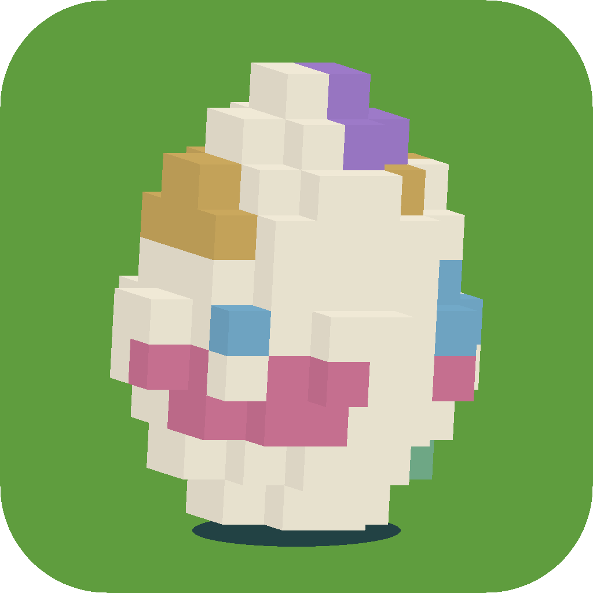

# TokenPet

<p align="center">
  
</p>

一个小小的蛋，正在等待你用Token来孵化它。

## 本地浏览

直接双击仓库根目录的 **`index.html`**，不需要服务器、网络或账号。

也可以使用本地预览：

```sh
npm ci
npm run preview
```

打开 `http://127.0.0.1:4177/`。

## Cloudflare Pages

连接本仓库，直接发布仓库根目录：

| 设置 | 内容 |
| --- | --- |
| 生产分支 | `main` |
| 框架预设 | `None` |
| 根目录 | 留空，使用仓库根目录 |
| 构建命令 | `exit 0` |
| 构建输出目录 | `.` |

根目录的 `index.html` 是已构建的完整页面，可直接发布。修改设置后重新部署；自定义域名需在该 Pages 项目的「自定义域」中绑定。

## 修改与构建

```sh
npm ci
npm run build
```

- `src/main.js`：Three.js 体素模型、3D 字标、布局与跳动动画。
- `src/style.css`：全屏布局与少量控件。
- `src/page.html`：页面模板。
- `assets/TokenPet.png`：TokenPet 彩色 3D 方块蛋图标，构建时内嵌为网站 favicon，也用于本页展示。
- `index.html`：可直接发布的独立页面，脚本和样式均内嵌。
- `dist/index.html`：同一页面的副本，保留给现有本地预览与 `dist` 部署配置。

支持触屏、键盘和减少动态效果设置；暂停或隐藏页面时停止动画循环。所有图形均由代码生成，无贴图、外部字体、统计或网络请求。

视觉布局参考 [Poteto Playground](https://www.poteto.com/)，使用原创的方块蛋与体素字标，没有使用其角色素材。

品牌名称：**TokenPet**，域名：**TokenPet.ai**。部署与域名绑定在 Cloudflare Pages 后台配置。

Three.js r180 遵循 MIT 许可证，完整声明保存在 `licenses/three-LICENSE.txt`，并内嵌于独立 HTML 文件。
